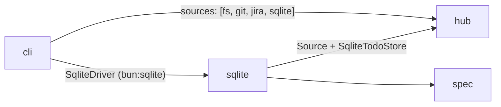

delivers: todo-md:n2

# SQLite source

A list whose tasks live in a SQLite file instead of Markdown: a new
`TodoStore` backend plus a `sqlite` hub source, so a registered project
opens in the CLI and the web app like any other.

This is the "database as one more adapter behind the same contract" of
[the architecture goals](../../architecture/README.md). It is not the two
SQLite uses the decision log puts off: a global index over existing lists,
and SQLite as the format of Jira's JSON mirror. Those stay deferred —
an index would go stale on every hand edit, and a mirror switch is a
re-sync ([decisions.md](../../architecture/decisions.md)).

## Decisions

| Point | Decided | Not chosen |
| --- | --- | --- |
| Reach | Store plus a `sqlite` hub source (`todo projects add --source sqlite`) | Store only: this repo's own tools could never open one |
| Capabilities | Every capability except `promote` — `allCapabilities` minus `promote`, as `MemoryTodoStore` declares | A flat core set (add/remove/edit/complete/reopen only) |
| Live changes | `watchList` over the database file and its `-wal`, as jira watches `mirror.json` | Polling `PRAGMA data_version`; no live changes |
| File location | Optional `path:` in the registry entry, else `~/.todo-md/projects/<name>/todo.db` | Always the data directory |
| First open | Empty: file and tables created on first open, title is the project name | Importing a Markdown list in this milestone (follow-up task) |
| Driver | A `SqliteDriver` Effect service defined in `src/sqlite`; the CLI provides it from `bun:sqlite` | `src/sqlite` importing `bun:sqlite` behind a boundaries exception |

`promote` is the only capability left out, and stays out for the reason
spec §1.5 gives: a database row has no file of its own to move a task
into, as with a store whose tasks have no separate document.

## The module

A new module `src/sqlite`, subpath `@lemol/todo-md/sqlite`, may import
`spec`, `hub`, `effect`. It holds:

- `SqliteTodoStore`: a `TodoStore` over one SQLite file.
- `sqliteSource`: a `Source<SqliteConfig>` turning a registry entry
  into that store.
- `SqliteDriver`: the Effect service through which all database access
  goes (open, run, query, transaction). The CLI provides it from
  `bun:sqlite` at the composition root in `src/cli/bin.ts`, beside
  `sources: [fsSource, gitSource, jiraSource, sqliteSource]`, the way
  git receives `ChildProcessSpawner`. No rule in
  `test/boundaries.test.ts` lets a module outside the apps import
  `bun`; `sqlite` gets a row like `jira`'s (`spec`, `hub`, `effect`).

## Schema

One file, one list. Tables are created on first open (`CREATE TABLE IF
NOT EXISTS`); a new list starts empty with the project's name as title.

| Table | Columns |
| --- | --- |
| `list` | single row: `title`, `description`, `last_id` |
| `groups` | `name` (PK), `description`, `position` |
| `tasks` | `id` (PK), `title`, `description`, `status` (`open`/`done`), `outcome`, `group_name` (null = ungrouped), `position`, `tags` (JSON), `assignee`, `depends_on` (JSON), `completed_at`, `cancelled_reason`, `extra` (JSON) |
| `comments` | `task_id` (FK), `position`, `author`, `at`, `body` |

Positions are integers per group (and per task for comments), rewritten
in the same transaction as a move; `ORDER BY position` is the list
order. IDs come from `list.last_id` incremented in the inserting
transaction, so they stay stable sequential decimal IDs (spec §1.2)
and are never reused after `remove`.

Array and free-form fields (`tags`, `depends_on`, `extra`) are JSON
columns decoded through the `spec` schemas on read, so a hand-edited
row that fails the schema surfaces through `diagnostics()` rather than
crashing `load()`.

## Semantics

- Every capability except `promote`: `capabilities` is
  `{ ...allCapabilities, promote: false }`. `promote` fails with
  `Unsupported`. The store passes `runConformance` with every case
  that does not require `promote`.
- `MemoryTodoStore` is the semantic reference: validation, transitions,
  dependency and placement behaviour match it; the conformance suite is
  the check.
- **Transactions in place of `.todo.lock`.** Each mutation runs in one
  SQLite transaction; SQLite's own locking serializes writers, so no
  lock file is needed. The file opens in WAL mode so the web app can
  read while the CLI writes. A failed operation rolls back whole —
  there is no partial write to recover from.
- Reads (`load`, `get`, `listDone`) see a consistent snapshot from one
  transaction.

## The source

`SqliteConfig` is `{ path?: string }`. The hub expands `~` in `path`
before decoding, as it does for other sources.

- **Location.** `path` when given, else
  `<dataDir>/todo.db` where `dataDir` is the project's directory under
  `~/.todo-md/projects/<name>/`. A project needs a name: the default
  location and title come from it.
- **No sync.** A local file has no remote; the source has no `sync`.
- **Changes.** `watchList` over the file's directory, ignoring every
  path except the database file and its `-wal` sibling — the jira
  mirror pattern in `src/jira/JiraSource.ts`. Bursts of writes arrive
  as one debounced event, which is all the web app needs.
- **Remove.** `beforeRemove` deletes the database file (and its `-wal`
  / `-shm`) only when the entry had no `path:` — i.e. only a file the
  hub placed itself. A file at a `path:` the user gave is left alone:
  removing the project unregisters it, nothing more.

`todo projects add --source sqlite` registers one: `--name` as usual,
plus a flag for the optional path. CLI help, flag descriptions and
examples follow the existing `projects add` entries, as
`test/cli/help.test.ts` requires.

## Out of scope

- Importing an existing Markdown list. Filed as a follow-up task in
  "Later", depending on this one; a copy between any two `TodoStore`s
  belongs in its own task.
- A cross-project SQLite index, and SQLite as the Jira mirror format.
  Both stay deferred per the decision log.
- Any new `effect` SQL dependency or a driver other than `bun:sqlite`.
  The `SqliteDriver` seam leaves room for one; nothing builds it.

## Checks

- `runConformance` passes for `SqliteTodoStore` with `promote` absent.
- `bun run check` passes, including the new boundaries row for
  `sqlite` and the `cli` module list gaining `sqlite`.
- `todo projects add --source sqlite`, then the CLI and web app add,
  complete, comment on and reorder tasks in that project; a second
  process's write reaches the open web app without a reload.
- Removing a project registered without `path:` deletes its
  `todo.db`; removing one with `path:` leaves that file untouched.
